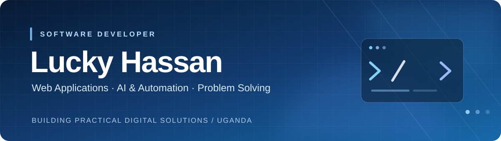

  

  <h3>Software Developer · Web Applications · AI &amp; Automation</h3>
  
Building practical digital solutions through code, curiosity, and continuous improvement.

  <a href="https://github.com/hassanlucky214-ops?tab=repositories">Explore my repositories</a>
  &nbsp;·&nbsp;
  <a href="https://github.com/hassanlucky214-ops">GitHub profile</a>

---

## About

I’m **Lucky Hassan**, a software developer based in **Uganda**. I’m interested in creating useful, reliable, and user-friendly software that addresses real business and everyday challenges.

My development interests span web application development, backend systems, database-driven solutions, and the practical use of AI and automation. I enjoy taking an idea from planning through implementation, testing, and refinement.

## Areas of Focus

| Area | What I work on |
|---|---|
| **Web application development** | Responsive interfaces, application workflows, and full-stack solutions. |
| **Backend & databases** | Server-side logic, authentication, data management, and application structure. |
| **AI & automation** | Exploring intelligent tools and automation for practical use cases. |
| **Business software** | Systems that help organize operations, records, and decision-making. |

## Selected Projects

### [FXBoteurx](https://github.com/hassanlucky214-ops/fxboteurx)
A Python-based project focused on forex trading technology and automation.

**Project area:** Python · Automation · Trading technology

### [Africana Children's School](https://github.com/hassanlucky214-ops/Africana-children-s-school)
A school-focused software project supporting digital administration and school management workflows.

**Project area:** Web development · Education technology

### [Task Buddy](https://github.com/hassanlucky214-ops/Task-buddy)
A task-management project designed around organizing activities and supporting personal productivity.

**Project area:** Application development · Productivity

## Technologies & Tools

**Languages**  
`PHP` · `Python` · `JavaScript` · `TypeScript`

**Web development**  
`HTML` · `CSS` · `React` · `Next.js`

**Databases**  
`MySQL` · `PostgreSQL`

**Development tools**  
`Git` · `GitHub` · `Visual Studio Code` · `XAMPP` · `MetaTrader 5`

*This list reflects technologies I use or explore across projects; experience varies by tool and project.*

## Current Building Interests

- **SACCO management software** — digital workflows for members, savings, loans, and repayments.
- **Farm management software** — organizing farm records, activities, and day-to-day operations.
- **AI-assisted applications** — applying intelligent features where they provide practical value.

These are ongoing project areas; check the repositories for public releases and current implementation details.

## Working Principles

- Build for a clear, real-world problem.
- Keep interfaces straightforward and usable.
- Value readable, maintainable code and clear documentation.
- Test, learn, and improve iteratively.

## Connect

I’m open to connecting with fellow developers, discussing ideas, and collaborating on useful software projects.

**GitHub:** [@hassanlucky214-ops](https://github.com/hassanlucky214-ops)

---

  Build with purpose. Learn continuously. Improve every day.

